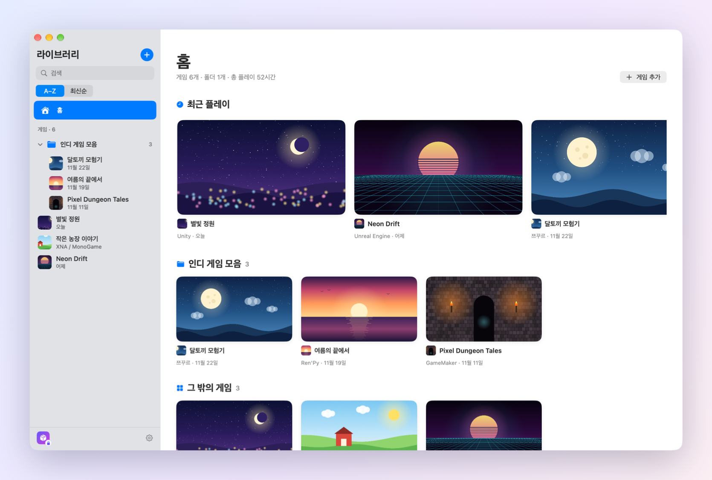
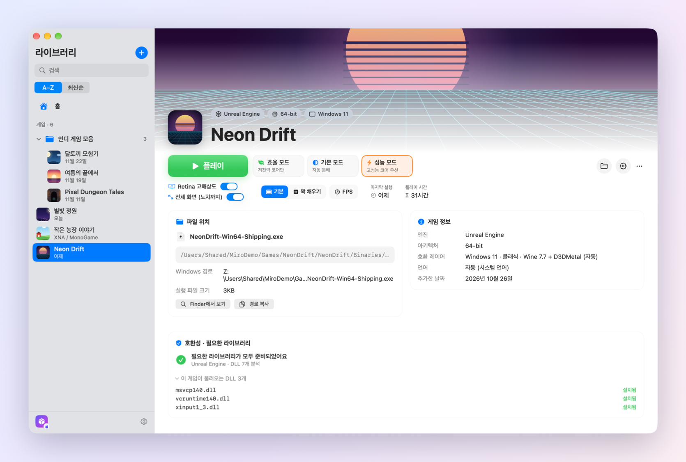
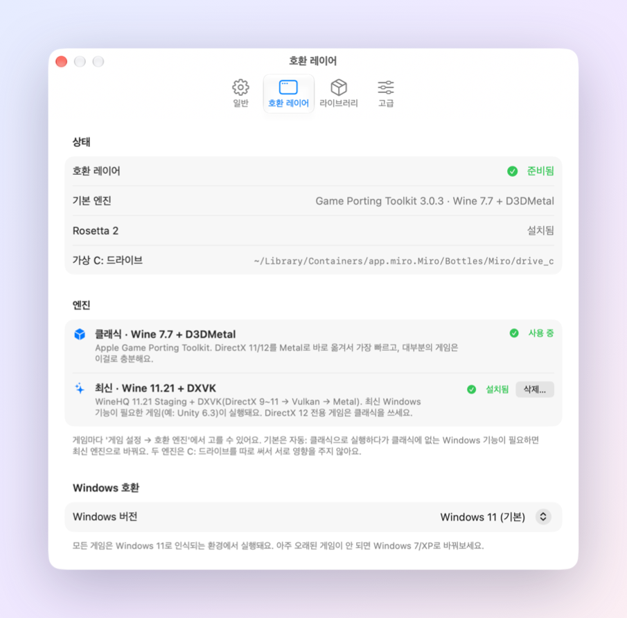

<div align="center">

# Miro ✦

**Windows 게임과 프로그램을, 호환성 걱정 없이 Mac에서.**

Apple 실리콘 Mac용 무료 오픈소스 Windows 게임·프로그램 런처

[](LICENSE)
[](https://github.com/boartat/Miro/releases/latest)


**[⬇︎ 다운로드](#다운로드)** · [화면 둘러보기](#화면-둘러보기) · [로드맵](#로드맵) · [가져온 것과 라이선스](#가져온-것과-라이선스) · [문의](#문의) · [English](#english)

</div>

> [!IMPORTANT]
> **Miro의 목표: 모든 Windows 게임과 프로그램이 호환성 걱정 없이 Mac에서 돌아가는 것.**
> 게임을 끌어다 놓고 플레이만 누르면 돼요. 어떤 Wine 엔진과 그래픽 방식이 맞는지, 어떤 라이브러리가 빠졌는지는 Miro가 찾아서 설치하고, 안 되면 다른 방식으로 바꿔 가며 실행해요. 로드맵과 테스트도 모두 이 목표를 향해요.

> [!NOTE]
> Miro는 혼자 만든 게 아니에요. [Whisky](https://github.com/Whisky-App/Whisky)를 바탕으로 [Wine](https://www.winehq.org), [DXMT](https://github.com/3Shain/dxmt), [DXVK-macOS](https://github.com/Gcenx/DXVK-macOS), [MoltenVK](https://github.com/KhronosGroup/MoltenVK), Apple [Game Porting Toolkit](https://developer.apple.com/games/game-porting-toolkit/), [Gcenx의 macOS 빌드](https://github.com/Gcenx/macOS_Wine_builds), [winetricks](https://github.com/Winetricks/winetricks) 같은 많은 오픈소스 위에 만들어졌어요. 무엇을 가져왔고 무엇을 직접 만들었는지는 [가져온 것과 라이선스](#가져온-것과-라이선스)에 모두 적어 뒀어요.

### 만든 사람의 말

Mac에서 Windows 게임·프로그램을 실행하는 무료 오픈소스 런처인 Miro 입니다. [Whisky](https://github.com/Whisky-App/Whisky)(GPL-3.0)를 포크해서 만들었습니다..

참고: 이 프로젝트는 생성형 ai인 claude를 활용하여 제작하였으며, 해당 프로그램은 수익을 창출하지 않습니다. 또한 유료화 계획도 없으며 순전히 개인의 호기심에서 시작한 프로젝트입니다.
그냥 제가 쓰기 편하라고 만든 앱이다 보니 어느정도 유지보수는 진행할거지만 어디까지 된다는 보장못합니다. 따라서 사용자분들의 보고가 큰 도움이 될겁니다.
현재 ai티가 많이 날텐데, 초기버전이라 디자인적으로 신경을 많이 못썼습니다...ㅠ 새로운 엔진 도입하면서 갈아엎어보도록 하겠습니다.

기존의 와인기반 윈도우 호환 프로그램들은 너무 복잡했습니다. 게임하나 실행하는데 정말 미로같았거든요. 그래서 직관적으로 잘 작동하는 프로그램이 없을까 싶어서 미로를 계획 하게 되었습니다.
레티나 디스플레이 모드로 진행시 노치부분까지 게임을 꽉 채워주는 기능도 존재합니다. 
기존에 윈도우 pc를 쓰다가 맥으로 넘어오게 되었는데 저는 좀 쯔꾸르나 유니티게임같은것들 많이 즐기는편이라.. 이거 못하는게 좀 컸거든요.
그런데 과장 조금 보태서 미로를 쓰면서 큰 걱정이 없어졌습니다. 게임뿐만 아니라 프로그램들도 실행할 수 있으니 편하고요.
exe만 넘기는게 아니라, 게임 폴더 째로 미로에 던져넣으면 자동으로 인식하는 기능도 있답니다.

어쨌든 여러분들도 저와 같은 경험을 해보셨으면 하네요. 사족이 너무 길었네요. 감사합니다.

**English:** Miro is a free, open-source launcher for Windows games and apps on Apple Silicon Macs. Drop a game folder in and press Play. Miro picks the Wine engine and graphics layer (D3DMetal, DXMT or DXVK), installs missing DLLs, and switches engines when one fails. [More in English ↓](#english)



## 핵심 기능

- **끌어다 놓으면 끝**: 게임 폴더를 창에 놓으면 등록돼요. 실행 파일이 여러 개면 알맞은 걸 골라 줘요.
- **빠진 DLL, 안전하게 자동 설치**
  - 실행 전에 게임 exe가 불러오는 DLL을 읽어서 필요한 라이브러리를 미리 보여 줘요.
  - 실행이 실패하면 Wine 로그에서 빠진 DLL을 찾아요. 아무거나 설치하지 않아요.
    - **미리 검증한 목록만 자동으로 설치해요**: 제조사 공식 재배포 패키지(Visual C++ 2005~2022, DirectX 런타임, XAudio·XInput, PhysX, OpenAL)예요.
    - **Windows·Wine 구성 요소를 바꾸는 패키지는 직접 눌러야 설치돼요**: .NET, Media Foundation, Visual C++ 6 등.
    - **공식 파일만 설치해요**: [winetricks](https://github.com/Winetricks/winetricks)가 Microsoft·NVIDIA·OpenAL 서버에서 받아요. 모든 파일은 SHA-256이 원본과 같아야 설치돼요. Microsoft가 내린 옛 DirectX 런타임은 원본과 해시가 똑같은 보관본에서 받아요.
    - **winetricks도 고정해요**: 버전과 해시를 고정해서, 스크립트가 바뀌면 실행하지 않아요.
  - **설치 전에 복구 지점을 만들어요**: 그 엔진의 C: 드라이브를 APFS 복제로 저장해요. 순간적으로 끝나고 공간도 거의 안 써요.
    - 설치가 실패하면 저절로 되돌려요.
    - 설치 뒤에 문제가 생기면 문제 해결 창이나 '설정 → 호환 레이어 → 복구 지점'에서 되돌릴 수 있어요. 되돌리기 직전 상태도 저장돼서 되돌리기도 취소할 수 있어요.
- **엔진·그래픽 자동 선택**: 최신 엔진(Wine 11)에서 게임이 쓰는 DirectX 버전에 맞춰 가장 효율적인 그래픽 방식(DXMT·D3DMetal·DXVK·Wine 기본)으로 실행해요. 안 되면 다음 방식, 그다음엔 클래식 엔진(Wine 7.7)으로 알아서 넘어가고, 잘 된 방식을 기억해요.
- **DirectX 9~12**: DXMT로 DirectX 10/11을 Metal로 바로 그려요(같은 화면에서 GPU를 DXVK의 3분의 1 정도만 써요). DirectX 12는 Apple D3DMetal이 맡아요.
- **Mac 보호 안전장치**: Wine이 프로세스를 끝없이 띄우면 Mac이 멈추기 전에 Wine을 멈춰요.
- **게임별 설정**: 효율(E코어만)·기본·성능 모드, 노치까지 채우는 전체 화면, Retina, FPS 표시, 언어, 그래픽 방식(자동·DXMT·D3DMetal·DXVK·Wine 기본)
- **스팀 같은 라이브러리**: 커버 이미지, 플레이 시간, 폴더, 숨김(시크릿 박스)

## 다운로드

**[⬇︎ Miro 최신 버전 받기 (Miro.zip)](https://github.com/boartat/Miro/releases/latest/download/Miro.zip)** · [모든 릴리즈](https://github.com/boartat/Miro/releases)

- Apple 실리콘 Mac(M1 이후), macOS 14 Sonoma 이상
- 첫 실행 때 호환 레이어(약 230MB)를 원래 배포처에서 내려받아요.

### 설치

1. `Miro.zip`을 풀고 `Miro.app`을 응용 프로그램 폴더로 옮겨요.
2. 처음 열면 "Apple이 악성 코드가 없음을 확인할 수 없습니다" 경고가 떠요. Miro는 애플 공증을 받지 않은 개인 프로젝트라서 그래요.
   - **완료**를 누르고 **시스템 설정 → 개인정보 보호 및 보안**으로 가서 맨 아래 "Miro"의 **그래도 열기**를 눌러요.
   - 또는 터미널에서 `xattr -dr com.apple.quarantine /Applications/Miro.app`을 한 번 실행해요.
3. 안 되는 게임이 있으면 [이슈](https://github.com/boartat/Miro/issues/new/choose)로 알려 주세요. 실행 로그(파일 메뉴 → 로그 폴더 열기, ⌘L)를 붙여 주면 큰 도움이 돼요.

## 화면 둘러보기

> 사진 속 게임은 화면 예시용으로 만든 데모예요(실제 게임이 아니에요). 어떤 게임이 어디까지 구동되는지는 [호환성 테스트](#호환성-테스트)로 계속 확인하고 있어요.

**게임 페이지**: 플레이 버튼 옆에서 효율·기본·성능 모드를 고르고, 아래에서 Retina·전체 화면·FPS 표시를 켜고 꺼요. 오른쪽 게임 정보에는 어떤 엔진으로 실행되는지 보여요.


**호환성 검사**: 게임 실행 파일이 불러오는 DLL을 읽어서, 필요한 라이브러리가 준비됐는지 보여 줘요.



**게임 설정**: 이름, 실행 인수, 언어, 호환 엔진(자동 / 클래식 / 최신), 그래픽, 커버 이미지를 바꿔요.


**설정**: 엔진을 나란히 관리하고, 게임에 자주 필요한 라이브러리를 한 번에 설치해요.

| 호환 레이어 · 엔진 | 라이브러리 |
| --- | --- |
|  |  |

## 로드맵

목표는 하나예요: **Windows 게임과 프로그램이 호환성 걱정 없이 모두 Mac에서 돌아가는 것.** 그래서 엔진을 늘리고, 고르는 걸 자동으로 만들고, 많이 시험해요.

**해낸 것**
- [x] 클래식 엔진: Wine 7.7 + D3DMetal (Apple Game Porting Toolkit)
- [x] 최신 엔진: Wine 11.21 Staging, 실패하면 자동으로 엔진 전환 (1.1)
- [x] 최신 엔진에서 DXMT, 게임별 DXMT / DXVK
- [x] 빠진 DLL 자동 진단·설치·재실행
- [x] 안전한 DLL 설치: 검증된 목록, 공식 배포처와 해시 확인, 설치 전 복구 지점과 자동 되돌리기 (1.2)
- [x] 화면 없는 그래픽 테스트와 벤치마크

**진행 중 (다음 릴리즈)**
- [ ] **엔진 하나로 DirectX 9~12 전부**: CrossOver 26.3 오픈소스 기반 Wine 11 엔진([Highball](https://github.com/gauthierpiarrette/highball)의 공개 빌드). D3DMetal·DXMT·DXVK·Wine 기본 그래픽을 한 엔진에서 바꿔 끼워요. 화면 밖 테스트에서 DirectX 11·12, 32비트, 3분 연속 실행, Unity 마우스 API, 이전 C: 드라이브 이어 쓰기를 통과했어요.
- [ ] **그래픽 방식 자동 순서** (구현 완료, 앱 안 검증 중)
  - 그 게임의 검증된 방식([highball-db](https://github.com/gauthierpiarrette/highball-db), CC0)이 있으면 그것부터 써요.
  - 없으면 DirectX 버전에 맞는 효율 순서로 시도해요.
    - DirectX 12: D3DMetal → Wine 자체
    - DirectX 10/11: DXMT → D3DMetal → DXVK
    - DirectX 9: Wine 자체 → DXVK
  - 실패하면 다음 방식으로 넘어가고, 성공하면 기억해요.

**다음**
- [ ] 실행 전에 안티치트 게임 알리기(커널 안티치트는 Mac에서 불가)
- [ ] 런처 지원: Steam, Epic, Battle.net, EA app
- [ ] 클래식 Wine 7.7 정리 → 엔진 하나로
- [ ] 영어 UI
- [ ] 애플 공증, 자동 업데이트

## 호환성 테스트

목표가 "모든 프로그램"이라서 테스트도 넓게 해요. 사용자의 게임이나 화면을 쓰지 않는 자동 테스트부터 늘려 가요.

| 영역 | 지금 | 다음 |
| --- | --- | --- |
| 그래픽 | D3D11(64·32비트), D3D12 컴퓨트, 창 크기 변경, 연속 실행, 벤치마크 | D3D9, D3D10, OpenGL, Vulkan, 여러 창 |
| 엔진 기능 | Unity 6.3 마우스 API, 새 C: 드라이브 만들기 | 파일·레지스트리·네트워크, 오디오, 게임패드 |
| 런타임 | Visual C++, DirectX(d3dx), .NET 4.8 설치 | .NET 8, XNA, Mono 게임 |
| 게임 엔진 | Unity, RPG Maker(쯔꾸르) 감지 | Unity·Unreal·쯔꾸르·Ren'Py·Godot 샘플 실행 |
| 런처 | | Steam, Epic, Battle.net, EA app 설치와 로그인 화면 |

안 되는 게임은 [이슈 양식](https://github.com/boartat/Miro/issues/new/choose)으로 알려 주세요. 결과를 모아서 공개하고, 같은 데이터를 쓰는 프로젝트(highball-db)에도 나눌 계획이에요.

<details>
<summary><b>기능 상세</b></summary>

- **라이브러리 (왼쪽 20%)**: A–Z / 최신순 정렬, 검색, `+` 버튼(⌘O)으로 게임 추가
- **홈**: 최근 플레이한 게임, 폴더별 게임, 나머지 게임이 카드로 보여요. 카드에 마우스를 올리면 바로 플레이할 수 있어요.
- **폴더**: 게임을 끌어서 다른 게임 위에 놓으면 폴더가 생겨요. 우클릭 → "폴더 만들기…"로 여러 개를 골라 묶을 수도 있어요.
- **숨기기 · 시크릿 박스**: 숨긴 게임은 비밀번호로 여는 시크릿 박스에서만 보여요(PBKDF2 해시로만 저장).
- **게임 페이지**: 커버 이미지, 플레이 버튼, 마지막 실행·플레이 시간
  - **게임별 프로필**: 효율 모드(저전력 E코어만, 실행 중에도 전환), 기본 모드, 성능 모드(P코어 우선)
  - **전체 화면(노치까지)**: Unity·Unreal·Godot 게임을 노치와 Dock 영역까지 채우는 테두리 없는 전체 화면으로 실행해요.
  - **기본 / 꽉 채우기 / FPS**: 원래 비율, 화면 높이에 맞춰 확대, Metal HUD(FPS·GPU 시간)
  - **Retina**: 끄면 해상도가 낮아져 발열이 줄어요.
  - **파일 위치·게임 정보·호환성 카드**: 경로, 크기, 게임 엔진(Unity, Unreal, 쯔꾸르 2000~MZ, 울프 에디터, Godot, GameMaker, Ren'Py, KiriKiri …), 32/64비트, 필요한 DLL
  - **커버 이미지**: 직접 선택, 끌어다 놓기, Steam 아트워크 자동 찾기(이름이 정확히 일치할 때만)
- **드래그 앤 드롭**: 게임 폴더는 `C:\Games\<폴더 이름>`으로 복사하고, exe만 놓으면 제자리에서 등록해요.
- **Windows 11 유지**: .NET 설치 등이 Windows 버전을 바꿔 놓으면 자동으로 Windows 11로 되돌려요.
- **첫 실행 설정**: Rosetta 2 → 호환 레이어 → Windows 11 환경 → 게임 라이브러리를 한 번에 설치
  - 기본: Visual C++ 2005~2022, DirectX 9/10/11(d3dx), D3D 셰이더 컴파일러 43/47, XACT/XAudio2, XInput, DirectMusic, PhysX, OpenAL, 한국어·일본어 글꼴
  - 선택: .NET Framework 4.8, XNA 4.0, .NET 8 데스크톱, LAV 코덱
- **엔진**
  - **클래식**: Gcenx가 빌드한 Apple Game Porting Toolkit 3.0 (Wine 7.7 + D3DMetal)
  - **최신**: CrossOver 26.3 오픈소스 기반 Wine 11 (Highball의 공개 빌드) + DXMT / D3DMetal / DXVK / Wine 기본 그래픽
    - 설정 → 호환 레이어에서 설치해요(약 450MB, 부품마다 SHA-256 확인).
    - 이전 최신 엔진의 C: 드라이브를 복제해서 이어 써요. 세이브가 그대로 남아요.
    - D3DMetal은 Apple 라이선스에 동의하면 켜져요.
- **쯔꾸르 RTP**: RPG Maker 2000/2003/XP/VX/VX Ace 공식 RTP를 앱 안에서 받아 설치해요.
</details>

<details>
<summary><b>빌드 · 데이터 위치 · 구조</b></summary>

### 빌드

Xcode 16 이상, Apple 실리콘 Mac.

```bash
xcodebuild -project Miro.xcodeproj -scheme Miro -configuration Release -derivedDataPath build build
```

결과물은 `build/Build/Products/Release/Miro.app`(로컬 실행용 ad-hoc 서명)이에요. DXMT용 `winemac.so` 빌드는 [`Engine/winemac-dxmt`](Engine/winemac-dxmt), 스크린샷과 테스트는 [`CONTRIBUTING.md`](CONTRIBUTING.md)를 참고하세요.

### 데이터 위치

| 내용 | 위치 |
| --- | --- |
| 라이브러리·커버·아이콘 | `~/Library/Application Support/app.miro.Miro/Library` |
| Wine 런타임(클래식), winetricks | `~/Library/Application Support/app.miro.Miro/Libraries` |
| 최신 엔진 (Wine 11 CrossOver 26.3 트리) | `…/Libraries/Engines/cx26.3` (`engine`, `frameworks`, `renderers`; 경로는 짧게 유지해야 해요) |
| Windows 11 환경 (C: 드라이브) | `~/Library/Containers/app.miro.Miro/Bottles/Miro` (클래식), `…/Bottles/Miro-CX` (최신) |
| 셰이더 캐시 | `~/Library/Application Support/app.miro.Miro/ShaderCache` (DXVK), `…/ShaderCache/dxmt` (DXMT) |
| 폴더째 넣은 게임 | `…/Bottles/Miro/drive_c/Games` (= `C:\Games`) |
| 복구 지점 (엔진마다 최근 3개, 게임 파일 제외) | `…/Bottles/.miro-restore` |
| 실행·설치 로그 | `~/Library/Logs/app.miro.Miro` |

### 구조

- `Miro/Core`: 게임 모델, 라이브러리 저장소, Steam 아트워크
- `Miro/Analysis`: PE import 파서, 엔진 감지, 호환성 검사, Wine 로그 분석
- `Miro/Runtime`: 런타임 설치, 엔진(`WineEngine`, `EngineManager`), 라이브러리 설치 큐, 다운로드, 게임 실행
- `Miro/Views`: SwiftUI 화면
- `WhiskyKit`: Whisky의 Wine·PE 엔진(런타임 설치기를 GPTK용으로 수정)
- `Engine/winemac-dxmt`: DXMT용 Wine Mac 드라이버 패치와 빌드 스크립트
- `Engine/tests`: 화면 없는 그래픽 테스트
</details>

## 가져온 것과 라이선스

Miro 전체는 **GPL-3.0 이상**이에요. [Whisky](https://github.com/Whisky-App/Whisky)에서 이어받았고, 어떠한 보증도 없어요([`LICENSE`](LICENSE)). 구성 요소별 라이선스 전문은 [`THIRD_PARTY_NOTICES.md`](THIRD_PARTY_NOTICES.md)에 있고, 앱의 설정 → 일반 → 정보에도 표시돼요.

**Miro.app 안에 들어 있는 것**

| 구성 요소 | 라이선스 | 비고 |
| --- | --- | --- |
| Whisky (WhiskyKit, 썸네일 확장) | GPL-3.0 | Miro의 바탕. 고친 파일에는 `Modified for Miro, 2026.` 표시 |
| 게임별 호환성 데이터 (highball-db에서 추림) | CC0-1.0 | [`Miro/Data/compat-db.json`](Miro/Data/compat-db.json), [`Scripts/update_compat_db.swift`](Scripts/update_compat_db.swift) |
| cabextract 1.11 (libmspack 포함) | GPL-3.0 이상 / LGPL-2.1 | 릴리즈마다 소스 첨부 |
| SemanticVersion | Apache-2.0 | |

**설치할 때 원래 배포처에서 받는 것** (Miro가 다시 배포하지 않아요)

| 구성 요소 | 라이선스 | 받는 곳 |
| --- | --- | --- |
| Wine 7.7 + Apple D3DMetal (Game Porting Toolkit 빌드) | LGPL-2.1 / Apple 라이선스 | [Gcenx/game-porting-toolkit](https://github.com/Gcenx/game-porting-toolkit) |
| Wine 11 (CodeWeavers CrossOver 26.3 오픈소스 트리, Highball 빌드) | LGPL-2.1 | [highball-engine](https://github.com/gauthierpiarrette/highball-engine) (빌드 레시피·패치 공개) |
| 런타임 프레임워크 (GStreamer, MoltenVK, FreeType … + Apple D3DMetal) | 각 라이선스 (LGPL, Apache-2.0 …) / Apple 라이선스 | [Sikarugir-App/Template](https://github.com/Sikarugir-App/Template) |
| DXMT (Highball 브랜치) | MIT | [highball-engine](https://github.com/gauthierpiarrette/highball-engine), 원본 [3Shain/dxmt](https://github.com/3Shain/dxmt) |
| MoltenVK 1.4.2 (Highball 패치) | Apache-2.0 | [Highball](https://github.com/gauthierpiarrette/highball) |
| 오디오 보정 라이브러리, NVAPI 스텁 | MIT | [highball-engine](https://github.com/gauthierpiarrette/highball-engine) |
| DXVK-macOS 1.10.3 | zlib | [Gcenx/DXVK-macOS](https://github.com/Gcenx/DXVK-macOS) |
| winetricks | LGPL-2.1 | [Winetricks/winetricks](https://github.com/Winetricks/winetricks) |
| Visual C++, DirectX, .NET 등 | 각 배포사(대부분 Microsoft) | winetricks가 공식 배포처에서 받아요 |
| RPG Maker RTP | 각 RTP 라이선스 | rpgmakerweb.com |

Apple D3DMetal은 비상업적 배포만 허용되고 수정할 수 없어요. 그래서 Miro는 **무료로만** 배포하고, 애플 파일은 고치지 않아요.

**참고한 프로젝트** (코드는 넣지 않았어요)

| 프로젝트 | 참고한 것 |
| --- | --- |
| [Highball](https://github.com/gauthierpiarrette/highball) (GPL-3.0) | 엔진 조립 방식(그래픽 방식별 덮어씌우기, SHA-256 고정). 앱 코드는 가져오지 않았어요 |
| [CrossOver](https://www.codeweavers.com/crossover) 오픈소스 Wine (LGPL) | macOS용 Wine 드라이버 인터페이스 |
| [Sikarugir](https://github.com/Sikarugir-App) · [Gcenx](https://github.com/Gcenx) | macOS용 Wine·DXVK 빌드 |
| [WineForge](https://github.com/Alien4042x/WineForge) (LGPL) | 공식 Wine에 D3DMetal을 붙이는 다른 접근 (조사) |
| [UTM d3dmetal-native](https://github.com/utmapp/d3dmetal-native) (MIT) | D3DMetal이 기대하는 호스트 인터페이스 문서 |
| WineHQ 버그 [59388](https://bugs.winehq.org/show_bug.cgi?id=59388), [53847](https://bugs.winehq.org/show_bug.cgi?id=53847) | Unity 마우스·포인터 API |

Miro는 Apple, Microsoft, CodeWeavers, WineHQ, Valve, Whisky 프로젝트와 관계가 없어요. 각 이름과 상표는 해당 소유자의 것이에요.

## 문의

- 버그·호환성 보고: [이슈](https://github.com/boartat/Miro/issues/new/choose) (실행 로그를 붙여 주면 큰 도움이 돼요)
- 그 밖의 문의: [minjae@ovqo.dev](mailto:minjae@ovqo.dev)

## English

**Miro** is a free, open-source (GPL-3.0) launcher for Windows games and programs on Apple Silicon Macs. Its goal: **every Windows game and program running on a Mac, without compatibility worries.** The interface is Korean for now; English is on the roadmap.

- **Drop in and play.** Miro picks the Wine engine and the graphics layer, reads the game's PE imports, installs missing DLLs and relaunches on its own.
- **Careful library installs.** Only a vetted list of vendor redistributables (Visual C++, DirectX runtimes, XAudio/XInput, PhysX, OpenAL) is installed automatically; packages that replace Windows components (.NET, Media Foundation …) need a click. Everything comes from the vendors' own servers through a pinned, hash-checked winetricks. Before each install Miro takes an APFS-clone restore point of the C: drive, rolls back by itself if the install fails, and lets you roll back later from the troubleshooter or Settings.
- **Engines and graphics picked for you.** The modern engine is Wine 11 from CodeWeavers' open-source CrossOver 26.3 tree (Highball's build), with DXMT, D3DMetal, DXVK and Wine's own Direct3D. Miro orders them by the Direct3D version a game uses, moves on by itself when one fails, falls back to the classic Wine 7.7 + D3DMetal engine last, and remembers what worked.
- **DXMT graphics.** On the modern engine DXMT draws Direct3D 10/11 straight to Metal; at 60 FPS on the same scene it used about a third of DXVK's GPU time.
- **Mac safety.** A process-storm guard stops Wine before it can exhaust the Mac's process table.
- **Headless graphics tests.** [`Engine/tests`](Engine/tests) checks Direct3D 11 and 12 without showing anything on screen.

Contact: [issues](https://github.com/boartat/Miro/issues) for bugs and compatibility reports, [minjae@ovqo.dev](mailto:minjae@ovqo.dev) for anything else.

Built on Whisky, Wine, DXMT, DXVK-macOS, MoltenVK, Apple's Game Porting Toolkit, Gcenx's macOS builds and winetricks. See [the credits](#가져온-것과-라이선스). Not affiliated with Apple, Microsoft, CodeWeavers, WineHQ or Valve.
