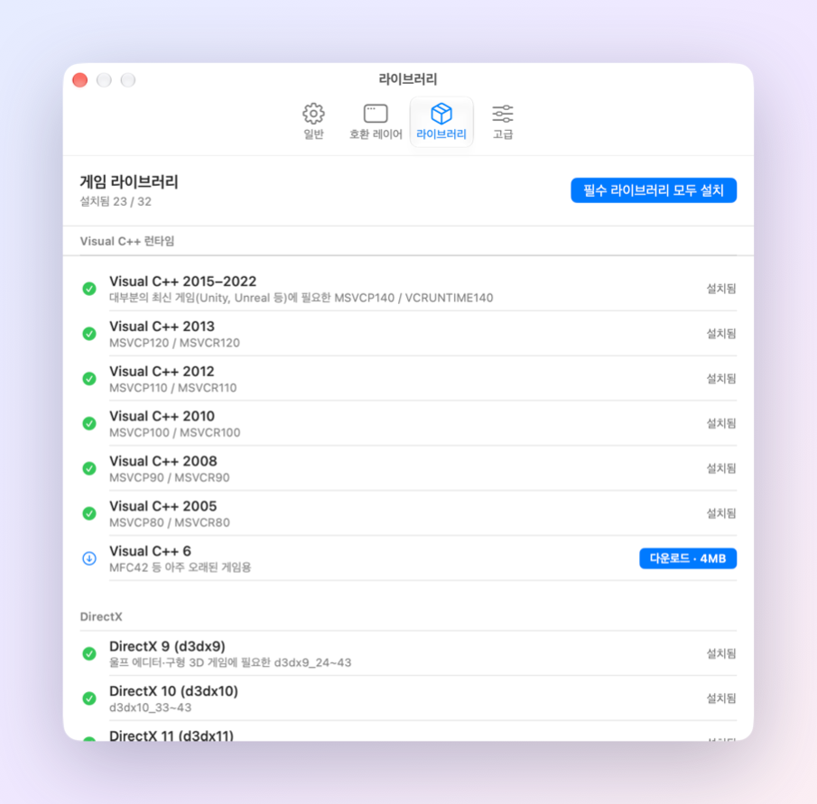

<div align="center">

# Miro ✦

**Windows 게임과 프로그램을, 호환성 걱정 없이 Mac에서.**

Apple 실리콘 Mac용 무료 오픈소스 Windows 게임·프로그램 런처

[](LICENSE)
[](https://github.com/boartat/Miro/releases/latest)


**[⬇︎ 다운로드](#다운로드)** · [화면 둘러보기](#화면-둘러보기) · [직접 푼 문제들](#miro가-직접-푼-문제들) · [로드맵](#로드맵) · [가져온 것과 라이선스](#가져온-것과-라이선스) · [English](#english)

</div>

> [!IMPORTANT]
> **Miro의 목표: 모든 Windows 게임과 프로그램이 호환성 걱정 없이 Mac에서 돌아가는 것.**
> 게임을 끌어다 놓고 플레이만 누르면 돼요. 어떤 Wine 엔진과 그래픽 방식이 맞는지, 어떤 라이브러리가 빠졌는지는 Miro가 찾아서 설치하고, 안 되면 다른 방식으로 바꿔 가며 실행해요. 로드맵과 테스트도 모두 이 목표를 향해요.

> [!NOTE]
> Miro는 혼자 만든 게 아니에요. [Whisky](https://github.com/Whisky-App/Whisky)를 바탕으로 [Wine](https://www.winehq.org), [DXMT](https://github.com/3Shain/dxmt), [DXVK-macOS](https://github.com/Gcenx/DXVK-macOS), [MoltenVK](https://github.com/KhronosGroup/MoltenVK), Apple [Game Porting Toolkit](https://developer.apple.com/games/game-porting-toolkit/), [Gcenx의 macOS 빌드](https://github.com/Gcenx/macOS_Wine_builds), [winetricks](https://github.com/Winetricks/winetricks) 같은 많은 오픈소스 위에 만들어졌어요. 무엇을 가져왔고 무엇을 직접 만들었는지는 [가져온 것과 라이선스](#가져온-것과-라이선스)에 모두 적어 뒀어요.

**English:** Miro is a free, open-source launcher for Windows games and apps on Apple Silicon Macs. Drop a game folder in and press Play. Miro picks the Wine engine and graphics layer (D3DMetal, DXMT or DXVK), installs missing DLLs, and switches engines when one fails. It also ships a DXMT bridge for official WineHQ Wine 11 builds. [More in English ↓](#english)


## 핵심 기능

- **끌어다 놓으면 끝**: 게임 폴더를 창에 놓으면 등록돼요. 실행 파일이 여러 개면 알맞은 걸 골라 줘요.
- **빠진 DLL 자동 설치**
  - 실행 전에 게임 exe가 불러오는 DLL을 읽어서 필요한 라이브러리를 미리 보여 줘요.
  - 실행이 실패하면 Wine 로그에서 빠진 DLL을 찾아요. 그 DLL이 든 패키지(Visual C++, DirectX, .NET …)를 받아 설치하고 바로 다시 실행해요.
- **엔진 자동 전환**: 클래식(Wine 7.7 + D3DMetal)으로 먼저 실행해요. 게임이 클래식에 없는 Windows 기능을 부르면 최신 엔진(Wine 11.21)으로 바꿔 다시 실행하고, 그 결과를 기억해요.
- **공식 Wine 11에서 DXMT**: DirectX 10/11을 Metal로 바로 그려요. 같은 화면에서 GPU를 DXVK의 3분의 1 정도만 써요. CrossOver 계열 빌드 없이 공식 WineHQ 빌드에서 동작하도록 Miro가 직접 변환층을 만들었어요([아래 설명](#miro가-직접-푼-문제들)).
- **Mac 보호 안전장치**: Wine이 프로세스를 끝없이 띄우면 Mac이 멈추기 전에 Wine을 멈춰요.
- **게임별 설정**: 효율(E코어만)·기본·성능 모드, 노치까지 채우는 전체 화면, Retina, FPS 표시, 언어, 그래픽 방식(자동·DXMT·DXVK)
- **스팀 같은 라이브러리**: 커버 이미지, 플레이 시간, 폴더, 숨김(시크릿 박스)

## 다운로드

**[⬇︎ Miro 최신 버전 받기 (Miro.zip)](https://github.com/boartat/Miro/releases/latest/download/Miro.zip)** · [모든 릴리즈](https://github.com/boartat/Miro/releases)

- Apple 실리콘 Mac(M1 이후), macOS 14 Sonoma 이상
- 첫 실행 때 호환 레이어(약 230MB)를 원래 배포처에서 내려받아요.

### 설치

1. `Miro.zip`을 풀고 `Miro.app`을 응용 프로그램 폴더로 옮겨요.
2. 처음 열면 "Apple이 악성 코드가 없음을 확인할 수 없습니다" 경고가 떠요. Miro는 애플 공증을 받지 않은 개인 프로젝트라서 그래요.
   - **완료**를 누르고 **시스템 설정 → 개인정보 보호 및 보안**으로 가서 맨 아래 "Miro"의 **그래도 열기**를 눌러요.
   - 또는 터미널에서 `xattr -dr com.apple.quarantine /Applications/Miro.app`을 한 번 실행해요.
3. 안 되는 게임이 있으면 [이슈](https://github.com/boartat/Miro/issues/new/choose)로 알려 주세요. 실행 로그(파일 메뉴 → 로그 폴더 열기, ⌘L)를 붙여 주면 큰 도움이 돼요.

## 화면 둘러보기

> 사진 속 게임은 화면 예시용으로 만든 가짜 데모 게임이에요.

**게임 페이지**: 플레이 버튼 옆에서 효율·기본·성능 모드를 고르고, 아래에서 Retina·전체 화면·FPS 표시를 켜고 꺼요. 오른쪽 게임 정보에는 어떤 엔진으로 실행되는지 보여요.


**호환성 검사**: 게임 실행 파일이 불러오는 DLL을 읽어서, 필요한 라이브러리가 준비됐는지 보여 줘요.


**게임 설정**: 이름, 실행 인수, 언어, 호환 엔진(자동 / 클래식 / 최신), 그래픽, 커버 이미지를 바꿔요.


**설정**: 엔진을 나란히 관리하고, 게임에 자주 필요한 라이브러리를 한 번에 설치해요.

| 호환 레이어 · 엔진 | 라이브러리 |
| --- | --- |
|  |  |

## Miro가 직접 푼 문제들

다른 프로젝트의 결과를 가져다 쓰지 않고 원인부터 직접 찾아서 해결한 것들이에요. 전부 오픈소스로 공개해요. Wine, DXMT, Mac 런처를 만드는 분들이 그대로 가져다 쓸 수 있게 기술적인 내용까지 적었어요. 제목을 누르면 펼쳐져요.

<details>
<summary><b>1. 공식 WineHQ Wine 11에서 DXMT가 동작하지 않던 문제: Wine의 Vulkan 방식을 따라 하는 변환층</b></summary>

**증상**: DXMT v0.80을 공식 WineHQ 11.21 빌드(Gcenx의 macOS 패키지)에 넣으면 장치는 만들어지지만 창에 그리지 못해요(`no exported symbols needed by DXMT`).

**흔한 해결책**: DXMT를 쓰는 다른 프로젝트들은 CrossOver 계열 Wine 빌드(Sikarugir, CrossOver 소스 빌드)를 써서 이 문제를 피해 가요. Miro는 공식 WineHQ 빌드에서 원인을 직접 찾았어요.

**원인 (세 가지가 겹쳐 있었어요)**
1. DXMT의 Unix 쪽 `winemetal.so`는 CrossOver가 제공하는 `macdrv_functions` 함수 표를, 없으면 `get_win_data` 같은 개별 함수를 `dlsym(RTLD_DEFAULT, …)`로 찾아요. 공식 빌드의 `winemac.so`는 `-fvisibility=hidden`으로 빌드돼서 공개 심볼이 둘뿐이고, 내부 심볼도 지워져 있어요. 그래서 런타임에 우회해서 찾을 수도 없었어요.
2. DXMT는 `get_win_data()`가 돌려주는 구조체의 앞 네 칸을 `{hwnd, cocoa_window, cocoa_view, client_cocoa_view}`로 읽어요. Wine 11의 `struct macdrv_win_data`는 `{hwnd, cocoa_window, client_view, rects, …}`예요. 함수만 공개하면 DXMT가 창 좌표(`rects`)를 뷰 포인터로 읽고 죽어요.
3. Wine 11은 창마다 고정된 클라이언트 뷰를 두지 않아요. Vulkan·OpenGL은 필요할 때 만드는 "클라이언트 표면"(`client_surface` / `macdrv_client_surface`)에 그리고, 그 뷰는 present할 때마다 다시 보이게 돼요. GDI로 창을 다시 그리면(`surface.c`) 숨겨져요.

**해결** ([`Engine/winemac-dxmt`](Engine/winemac-dxmt))
- `dlls/winemac.drv/dxmt.c`: DXMT가 기대하는 모양의 `macdrv_functions` 표를 공개해요.
- 이 표의 `get_win_data()`는 Wine의 실제 창 정보를 넘기지 않아요. Wine의 Vulkan 경로와 똑같이 `macdrv_CreateClientSurface(hwnd, 0, FALSE)`로 클라이언트 표면을 만들고, 그 뷰를 DXMT가 읽는 자리에 넣은 작은 기록을 돌려줘요. DXMT는 그 뷰 안에 Metal 뷰를 만들어요. Wine의 `MetalViewSwapChain`이 Vulkan을 위해 하는 것과 같은 방식이에요.
- DXMT는 `CAMetalLayer`에 바로 present하고 드라이버를 다시 부르지 않아요. 그래서 창이 움직이면 표면을 다시 present하고(`macdrv_dxmt_window_pos_changed`), GDI로 다시 그릴 때는 DXMT 뷰를 숨기지 않게 했어요(`macdrv_dxmt_owns_view`).
- 표면의 수명은 DXMT의 Metal 뷰와 같아요. DXMT를 쓰지 않는 게임에는 아무 영향이 없어요.
- `winemac.so`만 Wine 11.21 + Staging 소스로 다시 빌드해서 바꿔 끼워요. 엔진의 나머지는 공식 빌드 그대로예요.

**검증**
- Unity 6000.3 게임 타이틀 화면이 정상으로 그려졌어요.
- 화면 밖 D3D11 테스트(셰이더로 그리기 → 픽셀 읽기 → 창 크기 변경 후 다시 확인)를 통과했어요.
- 같은 화면을 60 FPS로 그릴 때 GPU 사용률이 DXMT 약 3.5%, DXVK 약 12%였어요.

Wine과 DXMT 쪽에 제안할 계획이에요.
</details>

<details>
<summary><b>2. 엔진 경로가 길면 Mac 전체가 멈추는 문제</b></summary>

**증상**: 경로가 긴 폴더(약 200자 이상)에 Wine 11 엔진을 두고 실행하면, 몇 분 동안 Mac에서 새 프로그램이 하나도 열리지 않았어요. 터미널도 `fork` 실패로 멈췄어요.

**원인**: Wine의 글꼴 초기화가 `<엔진>/share/wine/fonts` 경로를 260자(MAX_PATH) 버퍼에 복사해요. 경로가 넘치면 모든 Wine 프로세스가 시작하자마자 죽어요. 그러면 explorer.exe가 끝없이 다시 시작되면서 macOS의 사용자당 프로세스 한도를 다 써 버려요.

**해결**
- 엔진은 항상 짧은 경로(`…/Libraries/Engines/wine-11.21`)에 설치해요.
- 게임마다 프로세스 폭주 감시를 붙였어요. 엔진 폴더에서 실행된 프로세스 수를 세서(`proc_listpids` + `proc_pidpath`), 120개를 넘기 전에 그 엔진의 `wineserver -k`로 멈춰요. 원인을 안내하는 문구도 보여 줘요.
</details>

<details>
<summary><b>3. Unity 6.3 게임이 시작하자마자 꺼지는 문제 (IsMouseInPointerEnabled)</b></summary>

**원인**: Unity 6.3(6000.3)의 `UnityPlayer.dll`은 시작할 때 `IsMouseInPointerEnabled` / `EnableMouseInPointer`를 불러요. Apple Game Porting Toolkit의 Wine 7.7에서는 이게 `@ stub`이라 `unimplemented function user32.dll.IsMouseInPointerEnabled`로 바로 종료돼요.

**해결**
- Wine 11.x는 이 함수들과 마우스 → `WM_POINTER` 변환을 구현했어요. 2026년 2~7월 커밋이고, Wine 버그 59388과 관련 있어요.
- Miro는 로그에서 `unimplemented function …`을 찾으면 그 게임을 최신 엔진(Wine 11.21)으로 옮겨 바로 다시 실행하고 기억해요.
- 화면 없이 이 함수들을 직접 부르는 테스트로 엔진마다 확인해요.
</details>

<details>
<summary><b>4. Wine 7.7에 없는 Windows 부품을 직접 만들어 넣기 ("Failed to load il2cpp")</b></summary>

최신 Unity IL2CPP 게임은 `api-ms-win-core-winrt-robuffer-l1-1-0.dll`의 `RoGetBufferMarshaler`를 불러요. Wine 7.7에는 이 API-set DLL이 없지만, 같은 함수가 `wintypes.dll`에 이미 구현돼 있어요.

Miro는 기계어가 하나도 없는 아주 작은 DLL을 직접 만들어요. 내보내기 표만 있고, 그 표가 `wintypes.RoGetBufferMarshaler`로 연결돼요([`ShimDLL.swift`](Miro/Runtime/ShimDLL.swift)). 앱을 열 때 다운로드 없이 C: 드라이브에 넣어요.
</details>

<details>
<summary><b>5. 빠진 DLL 자동 진단과 설치</b></summary>

- **실행 전**: 게임 exe의 PE 가져오기 표와 지연 가져오기 표를 직접 읽어요([`PEInspector.swift`](Miro/Analysis/PEInspector.swift)). DLL마다 "게임 폴더에 있음 / 설치됨 / Wine 내장 / 없음"으로 나누고, 없는 DLL은 그걸 주는 패키지(winetricks 동사나 공식 설치 파일)와 짝지어요([`DependencyCatalog.swift`](Miro/Runtime/DependencyCatalog.swift)).
- **실행 후**: Wine 로그에서 `xxx.dll … not found`를 찾아요. Miro가 아는 패키지면 그 엔진의 C: 드라이브에 설치하고 다시 실행해요. 같은 패키지는 한 번만 시도해서 무한 반복을 막아요.
- **직접 넣어야 하는 파일**: `steam_api.dll` 같은 게임 전용 파일은 받을 수 없으니 따로 알려 줘요.
</details>

<details>
<summary><b>6. 엔진 두 개를 나란히, C: 드라이브는 복제로</b></summary>

- 엔진마다 C: 드라이브(Wine prefix)를 따로 써서, 새 엔진이 검증된 엔진의 환경을 바꾸지 않아요.
- 최신 엔진의 C: 드라이브는 클래식 C: 드라이브를 `cp -c`(APFS 복제)로 만들어서 추가 용량이 거의 없어요. 글꼴, Visual C++, .NET도 그대로 따라와요.
- `C:\Games`는 링크로 공유해서 게임 파일은 한 벌만 있어요.
</details>

<details>
<summary><b>7. 게임 없이, 화면 없이 그래픽 검증하기</b></summary>

[`Engine/tests`](Engine/tests)의 테스트는 화면 밖 작은 창이나 창 없이 돌아가요.
- **D3D11**: 셰이더로 그리기 → 픽셀 읽기 → 창 크기 변경 후 다시 확인
- **D3D12**: 컴퓨트 셰이더로 계산한 값 검증
- **Unity 마우스 API**: 앞의 3번에서 쓰는 함수 확인
- **벤치마크**와 **연속 실행**

Wine 안에 들어 있는 .NET Framework 컴파일러로 빌드하고, 오류 창이 뜨지 않게 디버거를 끄고 실행해요.

같은 Mac(M4 Pro)에서 잰 벤치마크예요(1프레임당 ms, 낮을수록 좋음).

| 그래픽 방식 | 무거운 셰이더 (1920×1080) | 그리기 명령 4000번 + 셰이더 전환 |
| --- | --- | --- |
| DXMT (Wine 11.21 + Miro 변환층) | 0.07 | 2.40 |
| D3DMetal (Wine 7.7) | 0.08 | 2.84 |
| DXVK 1.10.3 (Wine 11.21) | 0.28~0.33 | 6.17 |
</details>

<details>
<summary><b>8. Windows 컴파일러 없이 Wine 부품 하나만 빌드하기</b></summary>

Wine의 configure는 PE 크로스 컴파일러(mingw)가 없으면 진행하지 않아요. `winemac.so`는 macOS 쪽 코드라 PE 컴파일러가 필요 없어요. 그래서 configure 검사만 통과시키는 빈 컴파일러 스크립트를 쓰고, `make dlls/winemac.drv/winemac.so`만 빌드해요([`Engine/winemac-dxmt/build.sh`](Engine/winemac-dxmt/build.sh)). 약 100MB짜리 llvm-mingw를 받지 않아도 돼요.
</details>

## 로드맵

목표는 하나예요: **Windows 게임과 프로그램이 호환성 걱정 없이 모두 Mac에서 돌아가는 것.** 그래서 엔진을 늘리고, 고르는 걸 자동으로 만들고, 많이 시험해요.

**해낸 것**
- [x] 클래식 엔진: Wine 7.7 + D3DMetal (Apple Game Porting Toolkit)
- [x] 최신 엔진: Wine 11.21 Staging, 실패하면 자동으로 엔진 전환
- [x] 공식 Wine 11에서 DXMT (Miro 변환층), 게임별 DXMT / DXVK
- [x] 빠진 DLL 자동 진단·설치·재실행
- [x] 화면 없는 그래픽 테스트와 벤치마크

**진행 중**
- [ ] **엔진 하나로 DirectX 9~12 전부**: CrossOver 26.3 오픈소스 기반 Wine 11 엔진([Highball](https://github.com/gauthierpiarrette/highball)의 공개 빌드). D3DMetal·DXMT·DXVK를 한 엔진에서 바꿔 끼워요. 화면 밖 테스트에서 DirectX 11·12, 32비트, 3분 연속 실행, Unity 마우스 API를 통과했어요.
- [ ] **그래픽 방식 자동 순서**
  - 그 게임의 검증된 방식([highball-db](https://github.com/gauthierpiarrette/highball-db), CC0)이 있으면 그것부터 써요.
  - 없으면 DirectX 버전에 맞는 효율 순서로 시도해요.
    - DirectX 12: D3DMetal → Wine 자체
    - DirectX 10/11: DXMT → D3DMetal → DXVK
    - DirectX 9: Wine 자체 → DXVK
  - 실패하면 다음 방식으로 넘어가고, 성공하면 기억해요.

**다음**
- [ ] 실행 전에 안티치트 게임 알리기(커널 안티치트는 Mac에서 불가)
- [ ] 런처 지원: Steam, Epic, Battle.net, EA app
- [ ] 클래식 Wine 7.7 정리 → 엔진 하나로
- [ ] 영어 UI
- [ ] 애플 공증, 자동 업데이트
- [ ] Miro 변환층을 Wine·DXMT에 제안

## 호환성 테스트

목표가 "모든 프로그램"이라서 테스트도 넓게 해요. 사용자의 게임이나 화면을 쓰지 않는 자동 테스트부터 늘려 가요.

| 영역 | 지금 | 다음 |
| --- | --- | --- |
| 그래픽 | D3D11(64·32비트), D3D12 컴퓨트, 창 크기 변경, 연속 실행, 벤치마크 | D3D9, D3D10, OpenGL, Vulkan, 여러 창 |
| 엔진 기능 | Unity 6.3 마우스 API, 새 C: 드라이브 만들기 | 파일·레지스트리·네트워크, 오디오, 게임패드 |
| 런타임 | Visual C++, DirectX(d3dx), .NET 4.8 설치 | .NET 8, XNA, Mono 게임 |
| 게임 엔진 | Unity, RPG Maker(쯔꾸르) 감지 | Unity·Unreal·쯔꾸르·Ren'Py·Godot 샘플 실행 |
| 런처 | | Steam, Epic, Battle.net, EA app 설치와 로그인 화면 |

안 되는 게임은 [이슈 양식](https://github.com/boartat/Miro/issues/new/choose)으로 알려 주세요. 결과를 모아서 공개하고, 같은 데이터를 쓰는 프로젝트(highball-db)에도 나눌 계획이에요.

<details>
<summary><b>기능 상세</b></summary>

- **라이브러리 (왼쪽 20%)**: A–Z / 최신순 정렬, 검색, `+` 버튼(⌘O)으로 게임 추가
- **홈**: 최근 플레이한 게임, 폴더별 게임, 나머지 게임이 카드로 보여요. 카드에 마우스를 올리면 바로 플레이할 수 있어요.
- **폴더**: 게임을 끌어서 다른 게임 위에 놓으면 폴더가 생겨요. 우클릭 → "폴더 만들기…"로 여러 개를 골라 묶을 수도 있어요.
- **숨기기 · 시크릿 박스**: 숨긴 게임은 비밀번호로 여는 시크릿 박스에서만 보여요(PBKDF2 해시로만 저장).
- **게임 페이지**: 커버 이미지, 플레이 버튼, 마지막 실행·플레이 시간
  - **게임별 프로필**: 효율 모드(저전력 E코어만, 실행 중에도 전환), 기본 모드, 성능 모드(P코어 우선)
  - **전체 화면(노치까지)**: Unity·Unreal·Godot 게임을 노치와 Dock 영역까지 채우는 테두리 없는 전체 화면으로 실행해요.
  - **기본 / 꽉 채우기 / FPS**: 원래 비율, 화면 높이에 맞춰 확대, Metal HUD(FPS·GPU 시간)
  - **Retina**: 끄면 해상도가 낮아져 발열이 줄어요.
  - **파일 위치·게임 정보·호환성 카드**: 경로, 크기, 게임 엔진(Unity, Unreal, 쯔꾸르 2000~MZ, 울프 에디터, Godot, GameMaker, Ren'Py, KiriKiri …), 32/64비트, 필요한 DLL
  - **커버 이미지**: 직접 선택, 끌어다 놓기, Steam 아트워크 자동 찾기(이름이 정확히 일치할 때만)
- **드래그 앤 드롭**: 게임 폴더는 `C:\Games\<폴더 이름>`으로 복사하고, exe만 놓으면 제자리에서 등록해요.
- **Windows 11 유지**: .NET 설치 등이 Windows 버전을 바꿔 놓으면 자동으로 Windows 11로 되돌려요.
- **첫 실행 설정**: Rosetta 2 → 호환 레이어 → Windows 11 환경 → 게임 라이브러리를 한 번에 설치
  - 기본: Visual C++ 2005~2022, DirectX 9/10/11(d3dx), D3D 셰이더 컴파일러 43/47, XACT/XAudio2, XInput, DirectMusic, PhysX, OpenAL, 한국어·일본어 글꼴
  - 선택: .NET Framework 4.8, XNA 4.0, .NET 8 데스크톱, LAV 코덱
- **엔진**
  - **클래식**: Gcenx가 빌드한 Apple Game Porting Toolkit 3.0 (Wine 7.7 + D3DMetal)
  - **최신**: WineHQ 11.21 Staging (Gcenx의 공식 macOS 빌드) + DXMT v0.80 / DXVK-macOS 1.10.3
    - 설정 → 호환 레이어에서 설치해요(약 255MB, SHA-256 확인).
    - 예전에 설치했다면 "DXMT 추가"(약 18MB)로 DXMT를 넣어요.
- **쯔꾸르 RTP**: RPG Maker 2000/2003/XP/VX/VX Ace 공식 RTP를 앱 안에서 받아 설치해요.
</details>

<details>
<summary><b>빌드 · 데이터 위치 · 구조</b></summary>

### 빌드

Xcode 16 이상, Apple 실리콘 Mac.

```bash
xcodebuild -project Miro.xcodeproj -scheme Miro -configuration Release -derivedDataPath build build
```

결과물은 `build/Build/Products/Release/Miro.app`(로컬 실행용 ad-hoc 서명)이에요. DXMT용 `winemac.so` 빌드는 [`Engine/winemac-dxmt`](Engine/winemac-dxmt), 스크린샷과 테스트는 [`CONTRIBUTING.md`](CONTRIBUTING.md)를 참고하세요.

### 데이터 위치

| 내용 | 위치 |
| --- | --- |
| 라이브러리·커버·아이콘 | `~/Library/Application Support/app.miro.Miro/Library` |
| Wine 런타임(클래식), winetricks | `~/Library/Application Support/app.miro.Miro/Libraries` |
| 최신 엔진 (Wine 11 + DXMT / DXVK) | `…/Libraries/Engines/wine-11.21` (경로는 짧게 유지해야 해요). DXMT가 바꾼 원래 파일은 `miro/original` |
| Windows 11 환경 (C: 드라이브) | `~/Library/Containers/app.miro.Miro/Bottles/Miro` (클래식), `…/Bottles/Miro-W11` (최신) |
| 셰이더 캐시 | `~/Library/Application Support/app.miro.Miro/ShaderCache` (DXVK), `…/ShaderCache/dxmt` (DXMT) |
| 폴더째 넣은 게임 | `…/Bottles/Miro/drive_c/Games` (= `C:\Games`) |
| 실행·설치 로그 | `~/Library/Logs/app.miro.Miro` |

### 구조

- `Miro/Core`: 게임 모델, 라이브러리 저장소, Steam 아트워크
- `Miro/Analysis`: PE import 파서, 엔진 감지, 호환성 검사, Wine 로그 분석
- `Miro/Runtime`: 런타임 설치, 엔진(`WineEngine`, `EngineManager`), 라이브러리 설치 큐, 다운로드, 게임 실행
- `Miro/Views`: SwiftUI 화면
- `WhiskyKit`: Whisky의 Wine·PE 엔진(런타임 설치기를 GPTK용으로 수정)
- `Engine/winemac-dxmt`: DXMT 변환층 패치와 빌드 스크립트
- `Engine/tests`: 화면 없는 그래픽 테스트
</details>

## 가져온 것과 라이선스

Miro 전체는 **GPL-3.0 이상**이에요. [Whisky](https://github.com/Whisky-App/Whisky)에서 이어받았고, 어떠한 보증도 없어요([`LICENSE`](LICENSE)). 구성 요소별 라이선스 전문은 [`THIRD_PARTY_NOTICES.md`](THIRD_PARTY_NOTICES.md)에 있고, 앱의 설정 → 일반 → 정보에도 표시돼요.

**Miro.app 안에 들어 있는 것**

| 구성 요소 | 라이선스 | 비고 |
| --- | --- | --- |
| Whisky (WhiskyKit, 썸네일 확장) | GPL-3.0 | Miro의 바탕. 고친 파일에는 `Modified for Miro, 2026.` 표시 |
| DXMT용으로 고친 Wine Mac 드라이버 `winemac.so` | LGPL-2.1 이상 | 소스: [`Engine/winemac-dxmt`](Engine/winemac-dxmt), 릴리즈마다 전체 Wine 소스 첨부 |
| cabextract 1.11 (libmspack 포함) | GPL-3.0 이상 / LGPL-2.1 | 릴리즈마다 소스 첨부 |
| SemanticVersion | Apache-2.0 | |

**설치할 때 원래 배포처에서 받는 것** (Miro가 다시 배포하지 않아요)

| 구성 요소 | 라이선스 | 받는 곳 |
| --- | --- | --- |
| Wine 7.7 + Apple D3DMetal (Game Porting Toolkit 빌드) | LGPL-2.1 / Apple 라이선스 | [Gcenx/game-porting-toolkit](https://github.com/Gcenx/game-porting-toolkit) |
| Wine 11.21 Staging (MoltenVK 포함) | LGPL-2.1 / Apache-2.0 | [Gcenx/macOS_Wine_builds](https://github.com/Gcenx/macOS_Wine_builds) |
| DXMT v0.80 | MIT | [3Shain/dxmt](https://github.com/3Shain/dxmt) |
| DXVK-macOS 1.10.3 | zlib | [Gcenx/DXVK-macOS](https://github.com/Gcenx/DXVK-macOS) |
| winetricks | LGPL-2.1 | [Winetricks/winetricks](https://github.com/Winetricks/winetricks) |
| Visual C++, DirectX, .NET 등 | 각 배포사(대부분 Microsoft) | winetricks가 공식 배포처에서 받아요 |
| RPG Maker RTP | 각 RTP 라이선스 | rpgmakerweb.com |

Apple D3DMetal은 비상업적 배포만 허용되고 수정할 수 없어요. 그래서 Miro는 **무료로만** 배포하고, 애플 파일은 고치지 않아요.

**참고한 프로젝트** (코드는 넣지 않았어요)

| 프로젝트 | 참고한 것 |
| --- | --- |
| [Highball](https://github.com/gauthierpiarrette/highball) · [highball-engine](https://github.com/gauthierpiarrette/highball-engine) (GPL-3.0 / LGPL) | 엔진 조립 방식(그래픽 방식별 덮어씌우기, SHA-256 고정), 다음 엔진 후보 |
| [highball-db](https://github.com/gauthierpiarrette/highball-db) (CC0) | 게임별 그래픽 방식 데이터 (자동 순서에 쓸 예정) |
| [CrossOver](https://www.codeweavers.com/crossover) 오픈소스 Wine (LGPL) | DXMT가 기대하는 `macdrv_functions` 인터페이스 |
| [Sikarugir](https://github.com/Sikarugir-App) · [Gcenx](https://github.com/Gcenx) | macOS용 Wine·DXVK 빌드 |
| [WineForge](https://github.com/Alien4042x/WineForge) (LGPL) | 공식 Wine에 D3DMetal을 붙이는 다른 접근 (조사) |
| [UTM d3dmetal-native](https://github.com/utmapp/d3dmetal-native) (MIT) | D3DMetal이 기대하는 호스트 인터페이스 문서 |
| WineHQ 버그 [59388](https://bugs.winehq.org/show_bug.cgi?id=59388), [53847](https://bugs.winehq.org/show_bug.cgi?id=53847) | Unity 마우스·포인터 API |

Miro는 Apple, Microsoft, CodeWeavers, WineHQ, Valve, Whisky 프로젝트와 관계가 없어요. 각 이름과 상표는 해당 소유자의 것이에요.

## English

**Miro** is a free, open-source (GPL-3.0) launcher for Windows games and programs on Apple Silicon Macs. Its goal: **every Windows game and program running on a Mac, without compatibility worries.** The interface is Korean for now; English is on the roadmap.

- **Drop in and play.** Miro picks the Wine engine and the graphics layer, reads the game's PE imports, installs missing DLLs (Visual C++, DirectX, .NET …) and relaunches on its own.
- **Two engines, automatic switching.** The classic engine is Wine 7.7 with D3DMetal (Game Porting Toolkit). The modern engine is WineHQ 11.21 Staging with DXMT or DXVK. A game that hits an `unimplemented function` on the classic engine moves to the modern one, and Miro remembers it.
- **DXMT on official WineHQ Wine 11.** Other projects use CrossOver-based builds for DXMT. Miro adds a small bridge to `winemac.drv` instead ([`Engine/winemac-dxmt`](Engine/winemac-dxmt)).
  - It exports the `macdrv_functions` table DXMT looks for.
  - Each window gets a client surface, the same way Wine's Vulkan path does, so DXMT never reads Wine 11's changed `struct macdrv_win_data`.
  - The surface follows window moves and stays visible across GDI flushes.
  - At 60 FPS on the same scene, DXMT used about a third of DXVK's GPU time.
- **Mac safety.** A process-storm guard stops Wine before it exhausts the Mac's process table. Running an engine from a long path used to cause exactly that: Wine's font path overflowed its MAX_PATH buffer.
- **Headless graphics tests.** [`Engine/tests`](Engine/tests) checks D3D11 and D3D12 by drawing off-screen and reading the pixels back, and includes a benchmark.

Built on Whisky, Wine, DXMT, DXVK-macOS, MoltenVK, Apple's Game Porting Toolkit, Gcenx's macOS builds and winetricks. See [the credits](#가져온-것과-라이선스). Not affiliated with Apple, Microsoft, CodeWeavers, WineHQ or Valve.
