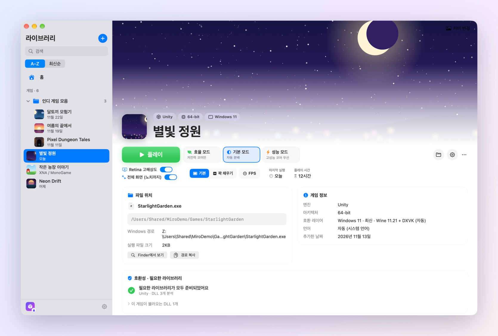
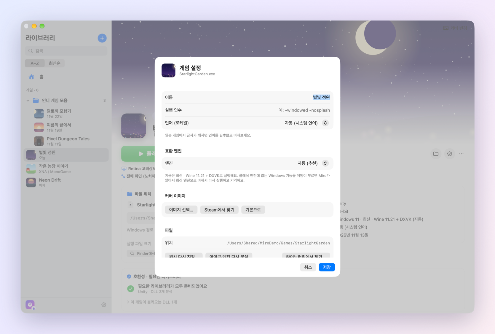

# Miro ✦

Mac에서 Windows 게임·프로그램을 실행하는 무료 오픈소스 런처예요. [Whisky](https://github.com/Whisky-App/Whisky)(GPL-3.0)를 포크해서 만들었어요.


## 다운로드

**[⬇︎ Miro 최신 버전 받기 (Miro.zip)](https://github.com/boartat/Miro/releases/latest/download/Miro.zip)** · [모든 릴리즈](https://github.com/boartat/Miro/releases)

- Apple 실리콘 Mac(M1 이후), macOS 14 Sonoma 이상
- 첫 실행 때 호환 레이어(약 230MB)를 원래 배포처에서 내려받아요.

### 설치

1. `Miro.zip`을 풀고 `Miro.app`을 응용 프로그램 폴더로 옮겨요.
2. 처음 열면 "Apple이 악성 코드가 없음을 확인할 수 없습니다" 경고가 떠요. Miro는 애플 공증을 받지 않은 개인 프로젝트라서 그래요.
   - **완료**를 누르고 **시스템 설정 → 개인정보 보호 및 보안**으로 가서 맨 아래 "Miro"의 **그래도 열기**를 눌러요.
   - 또는 터미널에서 `xattr -dr com.apple.quarantine /Applications/Miro.app`을 한 번 실행해요.
3. 안 되는 게임이 있으면 [이슈](https://github.com/boartat/Miro/issues)로 알려 주세요. 실행 로그(파일 메뉴 → 로그 폴더 열기, ⌘L)를 붙여 주면 큰 도움이 돼요.

## 화면 둘러보기

> 사진 속 게임은 화면 예시용으로 만든 가짜 데모 게임이에요.

**게임 페이지** — 플레이 버튼 옆에서 효율·기본·성능 모드를 고르고, 아래에서 Retina·전체 화면·FPS 표시를 켜고 꺼요. 오른쪽 게임 정보에는 어떤 엔진으로 실행되는지 보여요.



**호환성 검사** — 게임 실행 파일이 불러오는 DLL을 읽어서, 필요한 라이브러리가 준비됐는지 보여 줘요. 없으면 여기서 바로 설치해요.


**게임 설정** — 이름, 실행 인수, 언어, 호환 엔진(자동 / 클래식 / 최신), 커버 이미지를 바꿔요.



**설정** — 엔진 2개를 나란히 관리하고, 게임에 자주 필요한 라이브러리를 한 번에 설치해요.

| 호환 레이어 · 엔진 | 라이브러리 |
| --- | --- |
|  |  |

## 기능

- **라이브러리 (왼쪽 20%)**: A–Z / 최신순 정렬, 검색, `+` 버튼(⌘O)으로 게임 추가
- **홈**: 목록 맨 위 "홈"을 누르면 최근 플레이한 게임, 폴더별 게임, 나머지 게임이 카드로 보여요. 카드에 마우스를 올리면 바로 플레이할 수 있어요.
- **폴더**: 게임을 끌어서 다른 게임 위에 놓으면 두 게임이 든 폴더가 생겨요(이름 입력 창이 떠요). 폴더 위에 놓으면 그 폴더에 들어가고, "홈" 위에 놓으면 폴더에서 빠져요. 게임을 우클릭해서 "폴더 만들기…"를 누르면 체크박스가 나타나요. 검색해도 체크한 항목은 그대로 남아요.
- **숨기기 · 시크릿 박스**: 게임을 우클릭해서 "숨기기"를 누르면 목록·홈·검색에서 사라지고, 사이드바 아래 시크릿 박스 아이콘에서만 볼 수 있어요. 처음 쓸 때 비밀번호를 정해요(PBKDF2 해시로만 저장).
- **게임 페이지 (오른쪽 80%)**: 스팀처럼 커버 이미지, 게임 이름, 플레이 버튼, 마지막 실행·플레이 시간
  - **게임별 프로필 (플레이 옆 박스)**: 효율 모드(저전력 E코어만, 발열↓ — 실행 중에도 바로 전환) / 기본 모드(macOS 자동 분배) / 성능 모드(P코어 우선, 타이머 지연 끔)
  - **전체 화면 (노치까지) 스위치 (플레이 아래)**: 기본은 켬. Unity·Unreal·Godot 게임을 노치와 Dock 영역까지 꽉 채운 화면 전체 해상도(예: 3024×1964, Retina 끄면 1512×982)의 테두리 없는 전체 화면으로 실행해요. 끄면 화면에 맞는 창 모드로 실행해요. 다른 엔진은 게임 안 설정에서 전체 화면을 켜면 같은 해상도로 채워져요.
  - **기본 / 꽉 채우기 / FPS 버튼 (플레이 옆)**: 기본은 게임 원래 비율 그대로(비율이 다르면 게임이 검은 띠를 그림), 꽉 채우기는 게임 비율 그대로 화면 높이에 맞춰 확대해 띠를 없애고 좌우 가장자리를 잘라요(Unity는 손쉬운 사용 권한으로 창을 가운데 맞춤, 실험 기능). FPS는 Metal HUD(FPS·GPU 시간)를 게임마다 켜고 꺼요.
  - **Retina 고해상도 스위치 (플레이 아래)**: 기본은 켬. 끄면 해상도가 낮아져 발열이 줄어요. 게임마다 따로 기억하고 실행할 때 적용해요.
  - **파일 위치 카드**: 실행 파일이 있는 폴더, Windows 경로, 실행 파일 크기(폴더째 넣은 게임은 전체 폴더 크기도), Finder에서 보기 / 경로 복사 / 위치 다시 지정
  - **게임 정보 카드**: 엔진(Unity, Unreal, 쯔꾸르 2000~MZ, 울프 에디터, Godot, GameMaker, Ren'Py, KiriKiri …), 32/64비트, 언어
  - **호환성 카드**: exe의 DLL import 테이블을 읽어서 필요한 라이브러리를 보여주고 한 번에 설치
  - 커버 이미지: 직접 선택, 창에 이미지 끌어다 놓기, 또는 Steam 아트워크 자동 찾기(이름이 정확히 일치할 때만)
- **드래그 앤 드롭**: 파일을 창으로 끌어오면 창 전체가 70% 흰색으로 덮이고 "파일을 넣어주세요"가 표시돼요.
  - **게임 폴더**를 놓으면 폴더째 Miro 안(`C:\Games\<폴더 이름>`)으로 복사해요(로딩바 표시). exe가 필요한 데이터·DLL이 함께 들어가요. exe가 여러 개면 어떤 걸로 실행할지 고르는 창이 떠요(추천 항목 미리 선택).
  - **exe만** 놓으면 그 파일만 제자리에서 등록해요.
  - 복사된 게임을 지울 때는 "게임 파일도 휴지통으로 이동"을 고를 수 있어요.
- **Windows 11 유지**: .NET 설치 등이 Windows 버전을 7/XP로 바꿔 놓으면, 설치가 끝날 때와 앱을 열 때 자동으로 Windows 11로 되돌려요.
- **Windows 11 호환 레이어 (엔진 2개)**: 가상 C: 드라이브는 Windows 11로 설정돼요.
  - **클래식**: Gcenx가 빌드한 Apple Game Porting Toolkit 3.0 (Wine 7.7 + D3DMetal, DirectX 11/12 → Metal). 가장 빠르고 기본값이에요.
  - **최신**: WineHQ 11.21 Staging (Gcenx의 공식 macOS 빌드). Wine 7.7에 없는 Windows 기능이 필요한 게임용이에요(예: Unity 6.3의 `IsMouseInPointerEnabled`). 설정 → 호환 레이어에서 설치(약 255MB, SHA-256 확인). 그래픽은 두 가지예요.
    - **DXMT v0.80**: DirectX 10/11을 Metal로 바로 그려요. 같은 화면을 60 FPS로 그릴 때 GPU를 DXVK의 3분의 1 정도만 써요. 공식 Wine에서는 DXMT가 동작하지 않아서, Miro가 Wine Mac 드라이버(`winemac.so`)를 고쳐서 넣어요([Engine/winemac-dxmt](Engine/winemac-dxmt)).
    - **DXVK-macOS 1.10.3**: DirectX 9~11 → Vulkan → MoltenVK → Metal.
    - 게임 설정 → 그래픽에서 자동(DXMT 우선) / DXMT / DXVK를 골라요. DXMT로 실행하다 실패하면 문제 해결 창에서 바로 DXVK로 다시 실행할 수 있어요. 예전에 최신 엔진을 설치했다면 설정 → 호환 레이어의 "DXMT 추가"(약 18MB)로 넣어요.
  - 두 엔진은 C: 드라이브를 따로 써요. 최신 엔진의 C: 드라이브는 클래식 C: 드라이브의 APFS 복제본(추가 용량 거의 없음)이고 `C:\Games`는 같은 폴더를 가리켜요.
  - **게임별 엔진**: 게임 설정 → 호환 엔진에서 자동 / 클래식 / 최신. 자동은 클래식으로 실행하다가 로그에 `unimplemented function …`이 나오면 최신 엔진으로 바꿔 바로 다시 실행하고 기억해요. 최신 엔진이 없으면 문제 해결 창에서 설치 후 다시 실행해요.
  - **안전장치**: Wine이 프로세스를 끝없이 띄우면(예: explorer.exe가 계속 다시 시작) 120개를 넘기 전에 그 엔진의 wineserver를 멈춰서 Mac이 멈추는 걸 막아요.
- **첫 실행 설정**: Rosetta 2 → 호환 레이어(약 230MB) → Windows 11 환경 → 게임 라이브러리를 로딩바와 함께 한 번에 설치
  - 기본: Visual C++ 2005~2022, DirectX 9/10/11(d3dx), D3D 셰이더 컴파일러 43/47, XACT/XAudio2, XInput, DirectMusic, PhysX, OpenAL, 한국어·일본어 글꼴
  - 선택: .NET Framework 4.8, XNA 4.0, .NET 8 데스크톱, LAV 코덱
- **실행 실패 시 원인 안내**: Wine 로그에서 `xxx.dll (which is needed by …) not found`를 찾아서 어떤 파일이 없는지, 어떤 패키지가 그 파일을 주는지 보여주고, 앱 안에서 로딩바로 다운로드·설치한 뒤 자동으로 다시 실행해요. 게임 전용 파일(예: `steam_api.dll`)은 "직접 넣어야 하는 파일"로 따로 알려줘요.
- **Windows 호환 파일 (Miro가 직접 생성)**: Wine 7.7에 없는 API-set DLL을 Wine 내장 함수로 연결하는 작은 DLL을 만들어 넣어요. 예: 최신 Unity IL2CPP 게임의 "Failed to load il2cpp" 원인인 `api-ms-win-core-winrt-robuffer-l1-1-0.dll` → `wintypes.RoGetBufferMarshaler`. 다운로드 없이 앱을 열 때 자동으로 설치돼요.
- **쯔꾸르 RTP**: RPG Maker 2000/2003/XP/VX/VX Ace 공식 RTP를 앱 안에서 받아 설치 프로그램을 실행해요.

## 빌드

Xcode 16 이상, Apple 실리콘 Mac.

```bash
xcodebuild -project Miro.xcodeproj -scheme Miro -configuration Release -derivedDataPath build build
```

결과물: `build/Build/Products/Release/Miro.app` (로컬 실행용 ad-hoc 서명)

앱 아이콘은 `swift Scripts/make_icon.swift Miro/Assets.xcassets/AppIcon.appiconset`으로 다시 만들 수 있어요.

## 데이터 위치

| 내용 | 위치 |
| --- | --- |
| 라이브러리·커버·아이콘 | `~/Library/Application Support/app.miro.Miro/Library` |
| Wine 런타임(클래식), winetricks | `~/Library/Application Support/app.miro.Miro/Libraries` |
| 최신 엔진 (Wine 11 + DXMT / DXVK) | `…/Libraries/Engines/wine-11.21` (경로를 짧게 유지해야 해요: Wine 글꼴 로더가 260자 버퍼를 써요). DXMT가 바꾼 원래 파일은 `miro/original` |
| Windows 11 환경 (C: 드라이브) | `~/Library/Containers/app.miro.Miro/Bottles/Miro` (클래식), `…/Bottles/Miro-W11` (최신) |
| 셰이더 캐시 | `~/Library/Application Support/app.miro.Miro/ShaderCache` (DXVK), `…/ShaderCache/dxmt` (DXMT) |
| 폴더째 넣은 게임 | `…/Bottles/Miro/drive_c/Games` (= `C:\Games`) |
| 실행·설치 로그 | `~/Library/Logs/app.miro.Miro` |

## 구조

- `Miro/Core` — 게임 모델, 라이브러리 저장소, Steam 아트워크
- `Miro/Analysis` — PE import 파서, 엔진 감지, 호환성 검사, Wine 로그 분석
- `Miro/Runtime` — 런타임 설치, 엔진(`WineEngine`, `EngineManager`), 라이브러리 설치 큐(winetricks / 직접 설치, 엔진별 C: 드라이브), 다운로드, 게임 실행
- `Miro/Views` — SwiftUI 화면
- `WhiskyKit` — Whisky의 Wine·PE 엔진 (런타임 설치기를 GPTK용으로 수정)

## 라이선스

GPL-3.0 이상 — Whisky에서 이어받았어요. [`LICENSE`](LICENSE)를 참고하세요. 어떠한 보증도 없어요.

Miro.app에는 Whisky 코드, SemanticVersion(Apache-2.0), cabextract 1.11(GPL-3.0), DXMT용으로 고친 Wine Mac 드라이버 `winemac.so`(LGPL-2.1)가 들어 있어요. cabextract와 고친 Wine의 소스는 각 릴리즈에 첨부돼요. Wine·DXVK·DXMT·D3DMetal 같은 호환 레이어 본체는 앱에 넣지 않고, 설치할 때 원래 배포처에서 내려받아요.

| 구성 요소 | 라이선스 | 비고 |
| --- | --- | --- |
| Wine (클래식·최신) | LGPL-2.1 | 소스: winehq.org, Gcenx/macOS_Wine_builds |
| DXVK-macOS | zlib | Gcenx/DXVK-macOS |
| DXMT v0.80 | MIT | 3Shain/dxmt (v0.80까지 MIT) |
| 고친 winemac.so (최신 엔진) | LGPL-2.1 | 소스: [Engine/winemac-dxmt](Engine/winemac-dxmt), 릴리즈 첨부 |
| MoltenVK (Wine 빌드에 포함) | Apache-2.0 | |
| winetricks | LGPL-2.1 | |
| Apple D3DMetal (Game Porting Toolkit) | Apple 라이선스 | 비상업적 배포만 허용, 수정 금지. 그래서 Miro는 무료로만 배포해요 |

전체 목록과 라이선스 전문은 [`THIRD_PARTY_NOTICES.md`](THIRD_PARTY_NOTICES.md)에 있어요.

Miro는 Apple, Microsoft, CodeWeavers, WineHQ, Valve, Whisky 프로젝트와 관계가 없어요. 각 이름과 상표는 해당 소유자의 것이에요.
